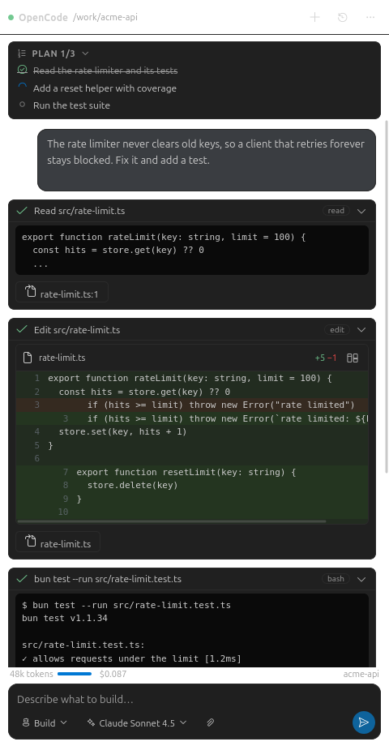

# OpenCode for VS Code

A native-feeling chat panel for [OpenCode](https://opencode.ai) inside VS Code.
It talks to the agent over the [Agent Client Protocol (ACP)](https://agentclientprotocol.com)
and renders everything — messages, tool calls, diffs, permission prompts and
questions — as a proper GUI. There is no embedded terminal and no console output
to sift through.



## What you get

- A **real chat surface**. Markdown, syntax-highlighted code blocks, copy buttons,
  and a composer with mode and model pickers that mirror what the agent offers.
- **Tool calls as cards.** Every read, edit, search and command collapses into a
  tidy row with a status icon. Expand it to see output, the files it touched, and
  an inline diff of what changed.
- **Diffs where you want them.** Render changes inline in the chat, or open them
  in VS Code's native diff editor. Click any file path to jump to it in the editor.
- **Permission prompts in context.** The agent asks inline, showing the exact
  command or diff, with a warning when a command looks destructive.
- **Agent questions.** When OpenCode needs input it raises a form, rendered as a
  small form card with single or multi-select choices.
- **Plans, retries, compaction and usage.** The checklist, the retry banner, the
  context-compaction marker, and a token/cost readout in the status strip.
- **Session history.** Browse previous chats for the workspace and resume any of
  them; the agent replays the transcript so nothing is lost.
- **Editor integration.** `Ask About Selection`, `Explain Selection` and
  `Ask About File` from the command palette or the editor context menu.

## Requirements

- VS Code 1.95 or newer
- [OpenCode](https://opencode.ai) v2 with ACP support (`opencode --version` should
  report 2.x). Sign in once with `opencode auth login`.

If `opencode` is not on your `PATH`, set `opencode.binaryPath` to the absolute
path printed by `which opencode`.

## Remote development (SSH, WSL, containers, Codespaces)

The extension declares `"extensionKind": ["workspace"]`, so it runs in the
**workspace** extension host, not the local one. Under Remote-SSH that means
`opencode` is started on the remote machine, and every file the agent reads or
writes, diff, and terminal is the remote one. Nothing needs to be configured
for this — it is the default.

Install the extension on the remote host: connect with Remote-SSH, then run
**Extensions: Install from VSIX…** and pick *Install in SSH: your-host* (not the
local one).

Two things are easy to get wrong:

- **Set `binaryPath` for the remote.** Put an absolute path in the
  *Remote [SSH: your-host]* scope in Settings, not just *User*. A path that
  works locally will not exist on the remote.
- **The extension host's `PATH` is not your login shell's.** The VS Code server
  is started by a non-interactive SSH command, so `~/.opencode/bin`,
  `~/.local/bin`, and nvm shims are often missing from it. If `binaryPath` is
  left as `opencode`, run `which opencode` *inside a VS Code terminal* — that
  terminal inherits the extension host's environment. If it is not found there,
  set an absolute path.

If the agent fails to start, the error names the host it tried to run on.

## Commands

| Command | What it does |
| --- | --- |
| `OpenCode: Open Chat` (`Ctrl+Alt+O`) | Focus the chat panel |
| `OpenCode: Open Chat in Editor Tab` | Open the same chat as a full editor tab |
| `OpenCode: New Chat` | Start a fresh conversation |
| `OpenCode: Resume Chat…` | Pick a previous chat from this workspace |
| `OpenCode: Stop Generating` | Cancel the current turn |
| `OpenCode: Ask About Selection` | Send the selection with a question |
| `OpenCode: Explain Selection` | Drop the selection into the composer |
| `OpenCode: Ask About File` | Reference the active file in the composer |
| `OpenCode: Sign In…` | Run `opencode auth login` in a VS Code terminal |
| `OpenCode: Restart Agent` | Restart the agent process |
| `OpenCode: Copy Last Response` | Copy the last assistant message |
| `OpenCode: Clear Local Chat History` | Start over |

## Settings

| Setting | Default | Description |
| --- | --- | --- |
| `opencode.binaryPath` | `opencode` | Path to the `opencode` executable |
| `opencode.extraArgs` | `[]` | Extra arguments before `acp`, e.g. `["--print-logs"]` |
| `opencode.env` | `{}` | Extra environment variables for the agent |
| `opencode.permissions` | `ask` | `ask`, `autoRead` (approve read-only tools) or `all` |
| `opencode.diffView` | `inline` | `inline`, `editor` (native diff) or `off` |
| `opencode.showThoughts` | `false` | Show the agent's reasoning stream |
| `opencode.showPlan` | `true` | Show the agent's execution plan |
| `opencode.fontSize` | `0` | Chat font size in pixels; `0` uses the default |
| `opencode.maxToolOutputLines` | `40` | Lines of tool output before collapsing |
| `opencode.confirmDestructiveCommands` | `true` | Warn before approving destructive commands |
| `opencode.reuseLastSession` | `true` | Reopen the previous chat on startup |

## How it works

The extension spawns `opencode acp` as a child process and speaks newline
delimited JSON-RPC (ACP v1) over its stdin/stdout using the official
`@agentclientprotocol/sdk`.

```
 webview (chat UI)  ⇄  WebviewHost  ⇄  ChatSession  ⇄  OpenCodeAgent  ⇄  opencode acp
```

- `OpenCodeAgent` owns the child process, negotiates capabilities during
  `initialize`, and exposes typed helpers for every ACP call the UI needs.
- `ChatSession` owns the conversation: it folds `session/update` notifications
  into an ordered transcript, and manages the request/response cycle for
  permission requests and elicitation questions.
- `ChatViewHost` keeps the webview in sync and routes user actions back to the
  session.
- The webview is plain TypeScript rendered into a sandboxed webview; every colour
  comes from VS Code theme variables, so the panel matches whatever theme you use.

A few deliberate choices:

- **No terminal capability is advertised.** OpenCode runs its own shell tool, so
  the chat never has to render a console.
- **File reads go through the editor**, so the agent sees unsaved buffer contents
  rather than what is on disk.
- **Diagnostics never touch the chat.** Agent logs go to the `OpenCode` output
  channel, which is only ever opened on request.

## Development

```sh
npm install
npm run build      # bundle the extension host and the webview
npm run watch      # rebuild on change
npm run compile    # type-check without emitting
npm test           # unit tests + extension bundle activation check
npm run smoke      # drive a real `opencode acp` and print the transcript
```

Press `F5` to launch an Extension Development Host with the extension loaded.

`npm test` covers the transcript reducer, the line diff, the markdown renderer
and the permission/form policies, then loads the built bundle against a stubbed
`vscode` API to confirm every command in `package.json` is actually registered.

`npm run smoke` spawns the real agent, performs `initialize` and `session/new`,
sends a prompt, and folds the resulting `session/update` stream through the same
reducer the extension uses. On a machine with no provider credentials it stops
at `auth_required` — which is the sign-in path it was designed to exercise.

### Previewing the UI

The webview can be rendered outside VS Code with sample data, which is the
fastest way to iterate on the interface:

```sh
npm run build
npm run preview            # writes screenshots of every scenario to dev/shots/
```

Scenarios: `transcript`, `permission`, `question`, `welcome`, `error`. Add
`&expand=N` to open the first `N` tool cards.

## License

MIT — see [LICENSE](LICENSE).